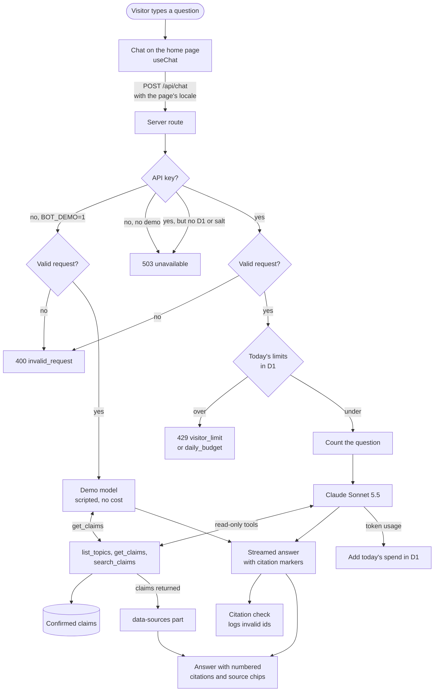

# How a question is answered

This is the whole path of one question, from the chat on the home page to the
streamed answer with its sources. Every step links to the file that does it.

The checks run in this order, so a request that fails validation never counts
against a visitor's limit.

## The steps

**The chat.** [`src/components/chat/Chat.tsx`](../src/components/chat/Chat.tsx)
uses the AI SDK's `useChat`, which posts the conversation to `/api/chat` and
reads the streamed answer. It sends only the latest 20 messages, starting with
a question, so a long conversation never hits the endpoint's cap; the screen
keeps the whole conversation, and the bot forgets the oldest turns. Each
question also carries the page's language as `locale`: `en` on `/`, `es` on
`/es`, read when it is sent, so a question asked after switching language
carries the new one. A counter in
[`Composer.tsx`](../src/components/chat/Composer.tsx) keeps a question under
1,000 characters, so the visitor never hits the endpoint's own limit.

**The route.** [`src/routes/api/chat.ts`](../src/routes/api/chat.ts) accepts
only `POST` and passes the request, the Worker's environment (vars, secrets
and the D1 binding) and the runtime's `waitUntil` to `handleChat` in
[`src/lib/bot/chat.ts`](../src/lib/bot/chat.ts), where every other step
starts.

**Key or demo.** With an Anthropic API key, the real model answers. Without
one, `BOT_DEMO=1` turns on demo mode, used by previews and the e2e tests; with
neither, the endpoint answers `503`. A key without the D1 binding or the
visitor salt also answers `503`, so a real model call never happens without the
limits in front of it.

**Validation.** The request body is parsed with Zod: at most 20 messages
(the chat never sends more, so this only stops forged requests), at
most 1,000 characters per visitor message, and the conversation must end with
the visitor's question. `locale` must be `en` or `es`; a request without it
counts as English, since a tab opened before the field existed doesn't send it.
Only the text of earlier messages reaches the model, so a visitor can't forge a
tool result in the history.

**The limits.** [`src/lib/bot/usage.ts`](../src/lib/bot/usage.ts) reads
today's counts from D1 (the tables are in
[`migrations/`](../migrations/0001_daily_limits.sql)) and
[`src/lib/bot/limits.ts`](../src/lib/bot/limits.ts) decides: 30 questions per
visitor a day, and $1.00 of estimated spend a day across everyone. A visitor is
a SHA-256 hash of their IP, the UTC date and a secret salt, so no IP is stored
and nobody can be followed from one day to the next. For an IPv6 address the
hash takes its /64 instead, since one person can rotate through all of it. Over a limit, the endpoint
answers `429` without calling the model.

**The model and its tools.** Claude Sonnet 5.5, set in
[`src/lib/bot/model.ts`](../src/lib/bot/model.ts), answers with the system
prompt in [`src/lib/bot/prompt.ts`](../src/lib/bot/prompt.ts), cached with
the tools, and a one-line note after it saying which page the visitor is
reading. The note sits after the cache breakpoint, so the cached prefix is the
same on both pages
([ADR](adr/2026-10-29-page-language-outside-the-cached-prompt.md)). The
prompt tells the model to answer in the visitor's language and to fall back to
the page's only when the question doesn't settle it. It can only
look things up through three read-only tools in
[`src/lib/bot/tools.ts`](../src/lib/bot/tools.ts), built from the claims Julian
has confirmed ([`src/lib/claims.ts`](../src/lib/claims.ts)). Demo mode,
[`src/lib/bot/demo.ts`](../src/lib/bot/demo.ts), is a scripted model that calls
the same `get_claims` tool and quotes the first claim it returns.

**Sources and citations.** Every claim a tool returns while answering is sent
to the browser as one `data-sources` part: its chip fields (`id`, `label`,
`org`, `source`), its text exactly as confirmed and `confirmedOn`, the date
Julian confirmed it, looked up in `confirmedClaims()` after the tool ran. The
UI shows the text and date when a claim is opened; the model never sees the
date, since the tools' output doesn't carry it. The answer cites claims as
`[[claim-id]]`; when it ends, the server parses the text with
[`src/lib/bot/citations.ts`](../src/lib/bot/citations.ts) and logs the ids of
any citation that no tool returned. Then the token usage of every step that
finished is added to today's estimated spend, once per answer, however it
ended: finished, failed, or stopped by the visitor. When the visitor presses
Stop or leaves, the request's abort signal cancels the model call, and the
server keeps reading the stream to its end inside `waitUntil`, so the write to
D1 still lands after they've gone. A
step cut off halfway isn't counted ([`docs/tech-debt.md`](tech-debt.md)).

**The answer on the page.** [`AssistantMessage.tsx`](../src/components/chat/AssistantMessage.tsx)
renders the text with the same parser. A citation becomes a numbered button and
a source chip with the same number, such as "1 · CV · Cazoo · Redux → Zustand",
only when its id is both cited in the text and in `data-sources`. Either one
opens the claim under the answer, with its text and when Julian confirmed it.
The text doesn't show at the stream's pace: what has arrived waits in a buffer
in the browser and types itself out word by word
([`reveal.ts`](../src/components/chat/reveal.ts)), and the chips, Copy and the
screen-reader announcement wait for the last word. The server and the model
know nothing of it.

**The evals.** [`evals/run-case.ts`](../evals/run-case.ts) asks the real model
its questions through `handleChat` itself, with a request shaped like
`useChat`'s, so every step above runs as it does in production: the
validation, the limits (with an in-memory store, so a long run never hits
them), the prompt, the tools and the citation check. There is no code path for
evals in `src/`. A second model then judges each answer against the claims the
tools returned. [`docs/evals.md`](evals.md) has how and the scores.

The reasons behind these choices are in [`docs/adr/`](adr/README.md).
